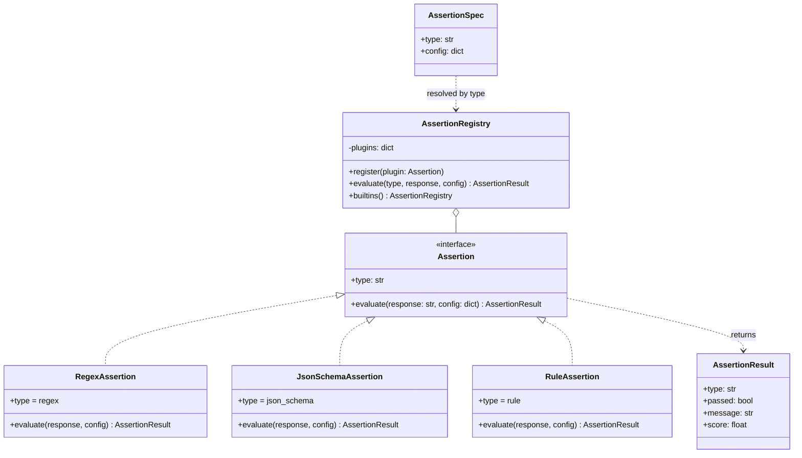
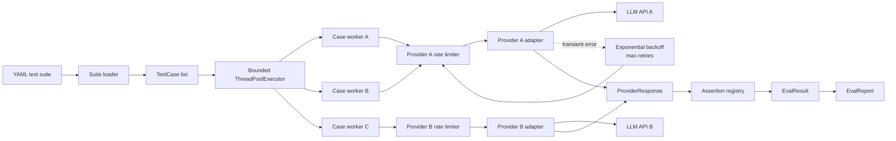
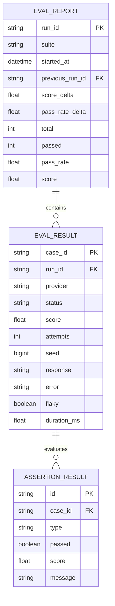
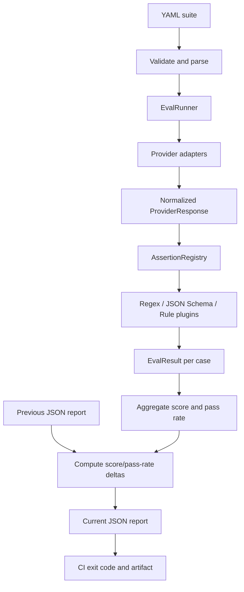

# LLM Evaluation Harness

An extensible, CI-friendly regression harness for LLM features. It reads a YAML suite, executes cases in parallel, applies deterministic assertions, retries transient provider failures, and writes a machine-readable report with score and pass-rate deltas against the previous run.

This is deliberately not an LLM-as-judge system. A case is evaluated only by regex, JSON Schema, or an explicit rule, making results reproducible and suitable for CI gates.

## Quick start

```bash
python3 -m pip install -e .
llm-eval examples/suite.yaml --output report.json --run-id build-123
```

The example uses the offline fixture provider, so it needs no credentials or network access. A successful run exits `0`; any non-passing case exits `1`.

Run the unit tests with:

```bash
python3 -m unittest discover -s tests -v
```

## Suite format

```yaml
name: checkout-regression
seed: 42
providers:
  default:
    responses:
      "What is the refund window?": "Refunds are available within 30 days."
tests:
  - id: refund-window
    prompt: "What is the refund window?"
    provider: default
    params: {temperature: 0}
    flaky_retries: 2
    assertions:
      - type: regex
        pattern: "30 days"
        ignore_case: true
```

Each test has a stable `id`, a prompt, a provider name, and one or more assertions. `params` are passed unchanged to the provider adapter. `flaky_retries` reruns an assertion-failing response and records a later success as `flaky`; flaky results still pass the suite gate but remain visible in the report.

Built-in assertions:

- `regex`: `pattern`, optional `ignore_case`.
- `json_schema`: a standard JSON Schema under `schema`.
- `rule`: `operation` (`equals`, `contains`, `regex`, `gte`, `lte`), optional JSON path (`$.field.0`) and `value`.

## Project phases and design coverage

The original brief defines three scored phases. The implementation below maps directly to each phase and keeps the boundaries explicit for extension and review.

### Phase 1 — Assertions: plugin architecture

The assertion layer is a Strategy/Registry plugin system. `Assertion` is the stable extension point; each plugin owns one deterministic assertion type and returns the common `AssertionResult` contract. `AssertionRegistry` resolves a YAML assertion type at runtime, so adding an assertion does not require changes to the runner.



The built-ins intentionally avoid probabilistic judges:

1. **Regex** checks a required pattern, optionally case-insensitively.
2. **JSON Schema** parses the response and validates its structure and types.
3. **Rule** evaluates explicit operations such as equality, containment, regex, numeric lower/upper bounds, and JSON-path extraction.

Every assertion result includes a pass/fail verdict, human-readable message, type, and normalized score. Unknown plugin types fail fast, which catches misspelled suite configuration before silently producing a misleading score.

### Phase 2 — Runner topology 

`EvalRunner` is the orchestration boundary. It fans cases out through a bounded worker pool, while provider-specific controls remain isolated by provider name. Each provider gets its own serialized rate limiter, so a slow or heavily capped provider does not consume another provider's quota.



The execution policy has two distinct retry loops:

- **Transient API retry:** retries only `TransientProviderError` (for example rate-limit, timeout, or temporary server failure), with bounded exponential backoff. Permanent provider errors are recorded without retrying.
- **Flaky retry:** after a successful API call whose assertions fail, reruns the case up to `flaky_retries`. A later pass is marked `flaky`, preserving the signal while allowing the suite to distinguish instability from a hard failure.

Seeds are derived as `SHA256(suite_seed + case_id)` and passed to every provider call. This makes the seed independent of worker ordering. Adapters pass it through only where the provider supports deterministic generation; the harness does not pretend to control providers that ignore seeds.

### Phase 3 — Result schema 

The result model has run-level, case-level, and assertion-level records. It is serialized as JSON for CI artifacts and can be loaded into relational tables without losing the one-to-many relationships.



The JSON representation keeps the same shape:

```json
{
  "run_id": "build-123",
  "previous_run_id": "build-122",
  "summary": {
    "total": 2,
    "passed": 2,
    "failed": 0,
    "pass_rate": 1.0,
    "score": 1.0,
    "score_delta": 0.05,
    "pass_rate_delta": 0.1
  },
  "results": [{
    "case_id": "refund-window",
    "provider": "default",
    "status": "passed",
    "score": 1.0,
    "attempts": 1,
    "seed": 2471614725125771178,
    "assertions": [{
      "type": "regex",
      "passed": true,
      "message": "pattern matched",
      "score": 1.0
    }],
    "response": "Refunds are available within 30 days.",
    "error": null,
    "flaky": false,
    "duration_ms": 4.2
  }]
}
```

`score` is the mean assertion score for a case and the mean case score for a run. `pass_rate` is the count of passed cases divided by total cases. `flaky` cases count as passing for the CI gate after recovering, but remain explicitly marked so teams can track regressions in stability. Missing previous reports produce `null` deltas rather than invented baselines.

## End-to-end architecture

The project follows ports-and-adapters boundaries so production API clients can be added without changing evaluation logic.



`llm_eval.providers.Provider` is the provider port. Implement `complete(prompt, params, seed)` and register instances by name. `CallableProvider` is convenient for tests; `FixtureProvider` is the deterministic offline adapter used by the example. Provider-specific concerns such as authentication, HTTP timeouts, and response normalization belong in an adapter.

`Assertion` is the plugin port. A plugin declares a unique `type` and implements `evaluate(response, config)`. Register it with `AssertionRegistry.register(...)`, then pass that registry to `EvalRunner`:

```python
from llm_eval.assertions import Assertion, AssertionRegistry
from llm_eval.runner import EvalRunner

class HasTicketId(Assertion):
    type = "has_ticket_id"
    def evaluate(self, response, config):
        # Return llm_eval.models.AssertionResult(...)
        ...

registry = AssertionRegistry.builtins()
registry.register(HasTicketId())
runner = EvalRunner(providers, registry=registry)
```

## Runner guarantees

- Cases execute concurrently through a bounded `ThreadPoolExecutor`.
- Each provider can have an independent requests-per-second limiter via `provider_limits`.
- Only `TransientProviderError` is retried, with bounded exponential backoff. Permanent errors fail without retrying.
- Seeds are derived from the suite seed and case ID using SHA-256, so ordering and worker scheduling do not change them. Adapters pass the seed to providers that support deterministic generation.
- A transient retry and a flaky retry are separate: transient retries recover an API call; flaky retries rerun failed assertions.
- Assertion outcomes are kept per case, including messages, score, attempts, seed, response, latency, error, and flaky status.

## Reports and CI

The JSON report contains run metadata, a summary (`total`, `passed`, `failed`, `pass_rate`, `score`, and deltas), and detailed results. To compare with an earlier artifact:

```bash
llm-eval examples/suite.yaml --previous previous-report.json --output report.json
```

Store `report.json` as a CI artifact and promote it to `previous-report.json` for the next build. The CLI exit code is the simplest CI policy; a stricter pipeline can parse `summary.score_delta` or individual assertion results and apply its own thresholds.

## Module map

| Module | Responsibility |
| --- | --- |
| `models.py` | Immutable suite/provider/assertion data and report serialization |
| `suite.py` | YAML parsing and basic suite validation |
| `assertions.py` | Plugin interface and built-in deterministic assertions |
| `providers.py` | Provider port plus offline/test adapters |
| `runner.py` | Parallel execution, per-provider limiting, retry policy, seeding |
| `reporting.py` | Atomic filesystem report history store |
| `cli.py` | CI-friendly command-line entry point |

## Production adapter checklist

Before connecting a real provider, an adapter should classify HTTP 429, timeouts, and selected 5xx responses as `TransientProviderError`; classify authentication, malformed requests, and unsupported models as `PermanentProviderError`; enforce a request timeout; normalize provider text into `ProviderResponse`; and pass through the seed only when the provider documents seed support. Never put API keys in the suite or report.

## Production-readiness additions

The repository includes the following hardening while remaining fully safe to demonstrate offline:

- **Provider adapter:** `OpenAICompatibleProvider` implements a standard chat-completion HTTP adapter with request timeouts, optional model and seed forwarding, response normalization, usage capture, and provider error classification. Its transport is injectable, so tests use an in-memory fake and never contact a real endpoint.
- **Authentication safety:** credentials are accepted only as an explicitly supplied value or an environment variable such as `LLM_EVAL_API_KEY`; suites and generated reports contain no credential fields. The example suite uses `FixtureProvider` and does not require any secret.
- **CI workflow:** `.github/workflows/ci.yml` installs Python and `uv`, runs the test suite with coverage, enforces an 80% coverage floor, and runs the offline example as a smoke test. No API secrets are configured or required.
- **Coverage:** development dependencies and coverage settings live in `pyproject.toml`. The local equivalent is:

  ```bash
  uv run --group dev coverage run -m unittest discover -s tests -v
  uv run --group dev coverage report
  ```

- **Broader tests:** tests cover built-in assertions, deterministic seeds, parallel runner behavior, transient retries, flaky retries, YAML loading, report persistence, HTTP request construction, timeout classification, and permanent HTTP failures.
- **Report history:** `JsonReportStore` writes reports atomically to a directory using a temporary file and `os.replace`, then supports loading a run or finding the latest artifact. This is a deliberately small CI-artifact backend; teams can replace it with S3, a database, or another store behind the same conceptual boundary.

### Safe provider-adapter example

The adapter is available for a future deployment but is not used by the demo:

```python
from llm_eval.providers import OpenAICompatibleProvider

provider = OpenAICompatibleProvider(
    "https://provider.example/v1/chat/completions",
    api_key_env="LLM_EVAL_API_KEY",
    timeout_seconds=30,
    model="your-model",
)
```

No request is made until `complete(...)` is called. In this repository, all automated tests inject a fake transport and the documented example uses local fixtures. This means the project can be cloned, tested, and showcased without an API account, network call, or credential.

### Local verification with uv

`uv` is the recommended reproducible developer workflow:

```bash
uv venv
uv sync --dev
uv run --group dev coverage run -m unittest discover -s tests -v
uv run --group dev coverage report
uv run llm-eval examples/suite.yaml --output report.json --run-id local
```

> Note: The project is deployable as a Python package or executable in GitHub Actions. “Deployable” here means the harness itself is ready to run in CI; a real provider still requires a separately supplied endpoint, credentials, timeout policy, and provider-specific adapter configuration.
